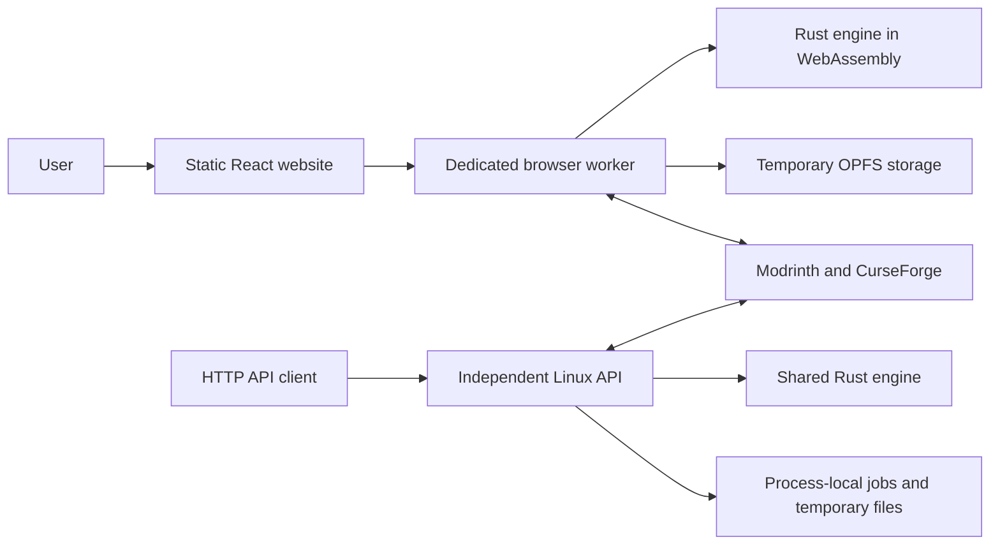

<div align="center">
  
  <h1>Modpack Migrator</h1>
  <hr>
  <p><strong>Two independent distributions in one project: browser-local migration, a Linux HTTP API, and a shared Rust engine.</strong></p>
  <p>
    
    
    
    
  </p>
  <p>
    <a href="https://github.com/hhhhhffd/modpacks-migrator/actions/workflows/checks.yml"></a>
    <a href="https://github.com/hhhhhffd/modpacks-migrator/actions/workflows/build-artifacts.yml"></a>
    <a href="LICENSE"></a>
  </p>
  <p><a href="https://github.com/hhhhhffd/modpacks-migrator/releases">Download</a> · <a href="#website">Website</a> · <a href="#architecture">Architecture</a> · <a href="#build">Build</a></p>
</div>

## Executive Summary

Modpack Migrator moves a ZIP of Minecraft mods to a different Minecraft version and loader. It identifies published files, resolves compatible alternatives and required dependencies, and lets users review selections before building a ZIP with a JSON report.

The static browser application runs the Rust engine as WebAssembly in a dedicated worker; the standalone Linux HTTP API runs the same engine on its host. The website does not use the API as a backend or proxy.

## Technical Stack

| Area | Technology | Responsibility |
|---|---|---|
| Core | Rust 1.88+, `zip`, SHA-1/SHA-2 | Archive validation, identification, resolution and packaging |
| Browser | React 19, TypeScript 5, Vite 6 | Review UI and typed worker facade |
| Browser | WebAssembly, wasm-bindgen 0.2.126, Fetch, OPFS | Local engine, provider transport and temporary artifacts |
| Linux API | Axum 0.8, Tokio 1, reqwest 0.12 | Independent HTTP jobs and provider transport |
| Automation | GitHub Actions, Playwright | Checks, browser tests and manual artifact builds |
| Data | Modrinth and CurseForge APIs | Project metadata, compatible files and downloads |

## Architecture



Browser requests go directly to providers, not through the Linux API. No uploaded source archive is sent to an application server, although hashes, fingerprints and network requests are sent to selected providers. The Linux API processes uploaded archives on its host.

**Architecture decisions**

1. **Shared Rust engine, separate transports.** The core owns migration rules; browser Fetch and native HTTP remain separate because their networking and storage constraints differ.
2. **Browser worker and OPFS.** ZIP work stays off the UI thread and temporary artifacts use browser storage; unsupported or exhausted storage is reported explicitly.
3. **Review before conversion.** Analysis and resolution expose alternatives and dependency conflicts before verified files are packaged; the Linux API also offers unattended conversion.

## Project Structure

```text
.
├── build-support/          # Shared build-time credential handling
├── crates/
│   ├── core/               # Migration engine and archive rules
│   ├── server/             # Independent Linux HTTP API
│   └── wasm/               # Browser WebAssembly bindings
├── scripts/
│   ├── browser-smoke.mjs   # Local archive smoke test
│   ├── release-plugin.mjs  # Local signed plugin preparation
│   └── release-plugin.test.mjs # Signing helper tests
├── web/
│   ├── public/             # Icon, fonts and generated bindings
│   ├── src/                # React UI and worker SDK
│   └── tests/              # Playwright browser tests
├── .env.example            # Build and server settings template
├── Cargo.toml              # Rust workspace
└── LICENSE                 # AGPL-3.0-only license text
```

## Setup and Deployment

### Website

Prerequisites: Rust 1.88+, the `wasm32-unknown-unknown` target, Node.js 22+, npm and `wasm-bindgen-cli` **0.2.126**.

```sh
rustup target add wasm32-unknown-unknown
cargo install wasm-bindgen-cli --version 0.2.126 --locked
test -e .env || cp .env.example .env
# Set your own CURSEFORGE_API_KEY in .env without overwriting existing settings.
npm --prefix web ci
npm --prefix web run build:wasm
npm --prefix web run dev
```

Open [http://localhost:3000](http://localhost:3000). Select a pack ZIP, target Minecraft version and loader, then analyze. Search and filter matches, choose versions or explicitly replace projects, and click **Build modpack**. **Remove** excludes an entry and **Undo** restores its previous version choice. A separately displayed required dependency can be removed to block its mandatory dependents. Edits recalculate the current review without rescanning the archive.

Target versions come from Modrinth's current official catalog, grouped into releases, snapshots/prereleases and legacy alpha/beta. Arbitrary text is not accepted; if loading fails, the selector stays disabled until **Retry versions** succeeds.

Analysis keeps a bounded 32 MiB in-memory snapshot of provider responses, including errors, for selection edits. It is discarded on a new analysis or worker shutdown. Run **Analyze pack** again to refresh data or retry an unavailable provider; evicted entries may require another request. JAR downloads are not cached in this snapshot. The Linux API is independent of this browser cache.

A current browser on localhost or HTTPS needs WebAssembly, dedicated workers, Fetch, FileReaderSync and Origin Private File System (OPFS). The theme toggle remembers an explicit choice locally and applies it before first paint. Without a saved choice, the device theme is read once at page load; later device changes do not switch it. If storage is blocked, switching still works in the current tab.

Manrope provides locally hosted Latin, Cyrillic and Greek text with system fallbacks; IBM Plex Mono is used for technical labels. Font notices are in `web/public/fonts/`. The header links to the repository and the footer credits [hhhhhffd](https://github.com/hhhhhffd).

### Build

```sh
npm --prefix web run build:wasm
npm --prefix web run build
```

Serve `web/dist/` at the root of a static HTTP(S) origin. It includes the application and generated WASM bindings; no backend is required. The development server uses port 3000 with strict port checking.

For a build without CurseForge, use `npm --prefix web run build:wasm:no-default` instead of `build:wasm`; Modrinth remains available. Do not run it over a generated CF-enabled package unless you intend to disable that provider.

The manually dispatched [Build artifacts workflow](.github/workflows/build-artifacts.yml) defines Linux x86_64/aarch64 executable builds and browser archives without CurseForge or embedded credentials. These workflow definitions do not establish that remote builds have run or that ARM has been independently verified.

### Linux API

```sh
cargo build --release -p modpacks-migrator-server
./target/release/modpacks-migrator-server
```

For a build without the key/provider:

```sh
cargo build --release -p modpacks-migrator-server --no-default-features
```

> [!WARNING]
> The API has no authentication, accounts or database. An external bind exposes it to that network; deploy only in an environment appropriate for an unauthenticated processing API.

Jobs are process-local, expire after 30 idle minutes and disappear on restart. At most four jobs are retained and two operations run concurrently. Busy, expired and invalid requests return explicit errors; poll for progress.

<details>
<summary>Environment reference</summary>

Defaults are from `.env.example`; the credential is a build-time setting and the server settings are runtime values.

| Variable | Default | Purpose |
|---|---|---|
| `CURSEFORGE_API_KEY` | empty | Build-time CurseForge credential embedded in default native and WASM builds |
| `MODPACKS_MIGRATOR_BIND` | `127.0.0.1:8080` | Linux API listen address |
| `MODPACKS_MIGRATOR_MAX_UPLOAD_MIB` | `256` | Maximum uploaded ZIP size in MiB |

The build environment takes precedence over workspace `.env`; default CF-enabled builds fail clearly when the key is missing. `.env` is ignored by Git. Values are literal, including `$` in bcrypt-style keys; single-quoted values are supported. Never expose the key through a `VITE_*` variable.

> [!WARNING]
> A key embedded in a native or WASM binary is extractable. Reports do not include API headers or keys. Respect provider usage and distribution restrictions; a key does not override an author's download permissions.

</details>

### HTTP API

| Method | Path | Purpose |
|---|---|---|
| GET | `/health` | Health check |
| POST | `/api/v1/analyze` | Upload multipart `archive` and start analysis |
| POST | `/api/v1/resolve` | Resolve target and selections for a job |
| POST | `/api/v1/convert` | Start unattended multipart conversion |
| GET | `/api/v1/jobs/{id}` | Poll job status |
| GET | `/api/v1/jobs/{id}/preview` | Read resolution preview |
| POST | `/api/v1/jobs/{id}/convert` | Convert a resolved revision |
| GET | `/api/v1/jobs/{id}/report` | Read migration report |
| GET | `/api/v1/jobs/{id}/download` | Download packaged ZIP |
| POST | `/api/v1/jobs/{id}/cancel` | Cancel a job |
| GET | `/api/v1/search` | Search provider projects |
| GET | `/api/v1/candidates` | List compatible candidate versions |

```sh
curl http://localhost:8080/health
curl -F 'archive=@mods.zip' http://localhost:8080/api/v1/analyze
# Returns 202 {"jobId":"..."}; poll until state is "analyzed".
curl http://localhost:8080/api/v1/jobs/JOB_ID
curl -H 'Content-Type: application/json' \
  -d '{"jobId":"JOB_ID","target":{"minecraftVersion":"1.21.5","loader":"fabric"},"includeDependencies":true}' \
  http://localhost:8080/api/v1/resolve
curl http://localhost:8080/api/v1/jobs/JOB_ID/preview
curl -H 'Content-Type: application/json' -d '{"revision":1}' \
  http://localhost:8080/api/v1/jobs/JOB_ID/convert
curl http://localhost:8080/api/v1/jobs/JOB_ID/report
curl -o migrated-modpack.zip http://localhost:8080/api/v1/jobs/JOB_ID/download
curl -X POST http://localhost:8080/api/v1/jobs/JOB_ID/cancel
curl 'http://localhost:8080/api/v1/search?provider=modrinth&query=sodium'
curl 'http://localhost:8080/api/v1/candidates?provider=modrinth&projectId=PROJECT_ID&minecraftVersion=1.21.5&loader=fabric'
```

For unattended conversion, `POST /api/v1/convert` accepts multipart `archive` and an `options` JSON field containing the resolve request, returning a job ID. Poll until `completed`, `partial`, `empty`, `failed` or `cancelled`; downloads are available after packaging.

Resolve options include `providers`, `includeDependencies`, `allowedChannels` (default: release, beta, alpha) and `selections`. Each selection contains `inputId` and either `exclude: true` or explicit `provider`, `projectId` and optional `versionId`. Each successful resolve advances the preview revision; a stale conversion revision returns `409`.

## Migration Rules and Limits

- Read JAR entries from raw ZIP archives, including nested directories. Non-JAR entries, including configs, are not migrated; `.mrpack` and manifest imports are unsupported.
- Identify original bytes by Modrinth SHA-512/SHA-1, then verified CurseForge fingerprints as fallback. A weak fingerprint or similar filename is insufficient.
- Select only provider-declared files compatible with the target Minecraft version and loader. Fabric, Quilt, Forge and NeoForge are distinct families. Propose the newest compatible release, beta or alpha with visible channel labels; older files can be selected.
- Add required API-declared dependencies by default, but not optional or embedded dependencies as separate mods. Exact dependency versions remain constraints; unresolved dependencies or conflicts exclude affected files and mandatory dependents. A manual replacement is not automatically equivalent to the original project for dependency satisfaction.
- Stage and verify downloads before ZIP construction. Downloads are sequential with bounded response sizes; no parallelism setting is exposed. A failed download excludes that file and mandatory dependents, with no automatic provider fallback after download failure.
- Produce `mods/` and `migration-report.json`; never mix old incompatible JARs into the migrated directory. Partial and empty results are explicitly distinguished from success.

This selects published builds; it does not rewrite mods, launch Minecraft, classify client/server mods or guarantee a working pack. Decisions are deterministic only for the same provider responses; live catalogs change. Reports include provider file hashes, but do not yet copy original input hashes or all resolve options into top-level provenance; the analysis response retains input hashes.

Default ZIP limits are 256 MiB input, 128 MiB per uncompressed entry, 512 MiB total uncompressed data, 10,000 entries and 16 path components. Unsafe paths, symlinks, encryption, unsupported compression, duplicate names, ZIP64 and multidisk archives are rejected.

<details>
<summary>Browser network limitations</summary>

A build-time key does not override CORS. CurseForge browser requests have been observed returning `405` to `OPTIONS` without `Access-Control-Allow-Origin`; a readable cross-origin response depends on the provider. A generic network error alone does not establish whether CORS, connectivity, TLS or a provider restriction caused it. Errors are displayed; there is no proxy or CORS bypass.

Browser transport removes the core's custom `User-Agent` and lets the browser supply it. In Firefox a custom header triggers a Modrinth CDN preflight that permits only range headers; Chromium silently drops the header and can hide the issue. This is normal Fetch usage, not a bypass. Linux retains its application `User-Agent`.

Browser requests do not automatically follow redirects, preventing credential leakage to redirect destinations; unsupported redirects fail explicitly. Linux downloads use a separately validated redirect flow.

</details>

## Browser SDK

The typed worker facade is in `web/src/migrator.ts`:

```ts
import { Migrator } from './migrator';
const migrator = new Migrator();
migrator.onprogress = event => console.log(event.stage, event.completed, event.total);
await migrator.analyzeZip(file);
const preview = await migrator.resolveMods({
  target: { minecraftVersion: '1.21.5', loader: 'fabric' },
  providers: ['modrinth', 'curseforge'],
  includeDependencies: true,
  allowedChannels: ['release', 'beta', 'alpha'],
  selections: [],
});
// Review preview before confirming.
const { archive, report } = await migrator.convertZip();
// archive is a Blob; save it using an object URL.
await migrator.dispose();
```

`convertZip()` requires prior analysis and resolution; it is not a one-step archive call. `searchProjects`, `listCandidates`, `cancel` and `dispose` are also available. Cancellation terminates the worker; analyze again to continue. Idle disposal closes OPFS handles in their owning worker before termination, allowing Firefox to release file locks.

After a build, generated bindings live in `web/public/pkg/`; the production build also creates `web/dist/sdk/migrator.js`, TypeScript declarations and a worker asset. Keep `sdk/` assets together and serve the accompanying `pkg/` directory at the origin root. A separately published npm SDK is not required for the website.

## Signed Launcher Plugin

The local preparer uses the launcher's Ed25519 + SHA-256 protocol, not OS code signing. It covers raw wasm-bindgen browser bindings, not the Linux API or entire website.

```sh
npm --prefix web run build:wasm
node scripts/release-plugin.mjs
```

Output contains exactly four files:

```text
plugin.json
plugin.json.sig
modpacks_migrator_wasm.js
modpacks_migrator_wasm_bg.wasm
```

The manifest identifies `modpacks-migrator`, uses the workspace version, plugin API `1`, and `minLauncher: "0.1.0"`; its `files` map contains SHA-256 hashes. The Base64 signature covers the exact bytes `_k0t1k-plugin\n` followed by unchanged `plugin.json` bytes. Signature and file integrity are checked before success.

The preparer uses `K0T1K_PLUGIN_KEY` or `~/.config/k0t1k/plugin-signing-key.pem`, requiring an Ed25519 key matching the launcher's existing pinned public key. It never creates or prints a private key or publishes anything. Existing output directories are rejected; without `--out`, a fresh directory under `.tmp/` is used. `--pkg` selects another prebuilt bindings directory. Preparation does not rebuild WASM or prove which source commit produced it: rebuild before signing to avoid stale `pkg` contents.

> [!WARNING]
> Default local builds include an extractable CurseForge key, including in the signed plugin. The intended public v1.0.0 plugin distribution includes that key; publish only with deliberate authorization and provider-policy review. Its four assets are the files above, not Linux or website archives.

Signing does not integrate the plugin. The current launcher registers only its existing plugins; it must register `modpacks-migrator` with `hhhhhffd/modpacks-migrator` and provide a baseline and worker/IO adapter for this project's `BrowserMigrator` exports. The minimum version records the manifest protocol, not automatic plugin support; the exports are not interchangeable with RatScan/packconv.

The launcher must verify with its built-in pinned public key, validate plugin ID, API and minimum version, reject non-newer releases, and check every downloaded file hash. Never replace the pinned key with one downloaded alongside a release; see the existing launcher verifier for rollback policy. Preparation changes no launcher files, installed plugins, GitHub tags or releases.

## Checks

```sh
cargo fmt --all -- --check
cargo test --workspace
cargo clippy --workspace --all-targets -- -D warnings
cargo check -p modpacks-migrator-wasm --target wasm32-unknown-unknown
npm --prefix web run build
npm --prefix web run test:e2e
node --test scripts/release-plugin.test.mjs
```

Default builds use the local/CI key; secret-free builds use `--no-default-features` and the no-default WASM build script. Provider tests use synthetic responses, not a live credential. Browser E2E exercises real WASM, worker and OPFS with controlled provider responses; live network checks are separate and not evidence of mocked coverage passing.

<details>
<summary>Local archive smoke tests</summary>

Against a running website:

```sh
node scripts/browser-smoke.mjs /path/to/mods.zip 1.21.5
```

Chromium uses `/usr/sbin/chromium` or `CHROMIUM_PATH` with browser sandbox support. For Firefox, install its Playwright binary and select it explicitly:

```sh
npm --prefix web exec -- playwright install firefox
PLAYWRIGHT_BROWSER=firefox npm --prefix web run test:e2e
PLAYWRIGHT_BROWSER=firefox node scripts/browser-smoke.mjs /path/to/mods.zip 26.1.1
```

Evidence and downloaded results go into ignored `.tmp/`. Real user archives are never committed or included in CI fixtures.

</details>

## Deliverables and Links

- [GitHub repository](https://github.com/hhhhhffd/modpacks-migrator) and [releases](https://github.com/hhhhhffd/modpacks-migrator/releases).
- Website: run or deploy the [local static build](#website); there is no public deployed site linked here.

## License

The project is licensed under [AGPL-3.0-only](LICENSE). Bundled font license notices are in `web/public/fonts/` under the SIL Open Font License.
